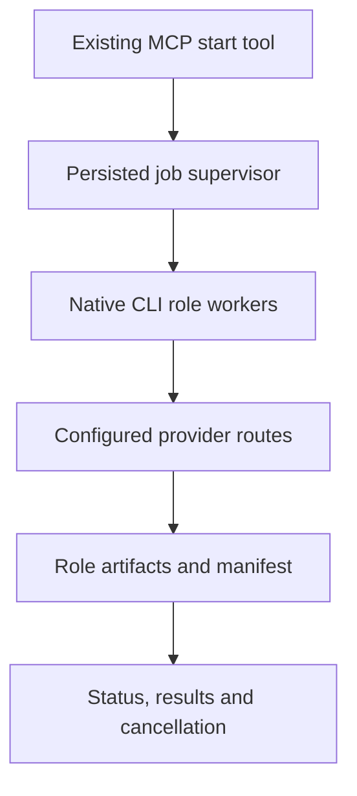

# Native CLI agent routing

Harness² can delegate a supplied task to configured cloud and subscription CLI agents through its existing MCP job lifecycle. The deployed Dell policy uses Ollama GLM Cloud for planner and reviewer, and native Codex with its ChatGPT CLI login for implementer. Local model profiles are opt-in.

This route returns role analyses and proposals. Its implementer does not modify project files, and its verifier derives acceptance conditions without running tests. The report records `engineering_validation_performed: false`. Engineering execution and acceptance require separate registered host operations and deterministic evidence.

## Architecture



The MCP call returns a run ID promptly. The supervisor enforces the aggregate wall deadline and cancellation. Each role keeps its prompt, CLI output and result record under the job's `delegation/` directory. A compact report appears at `workflow/workflow.json`.

The fixed execution registry currently implements these routes:

| Route | CLI | Provider selection |
| --- | --- | --- |
| `ollama_cloud_glm` | Ollama | Configured GLM Cloud model |
| `codex_chatgpt` | Codex | Native CLI ChatGPT login and CLI-selected model |
| `claude_subscription` | Claude Code | Native first-party CLI login and CLI-selected model |

Installing another client does not register an execution route. Inventory distinguishes executable presence, observed authentication, supported command contracts and actual execution outcomes. Authentication evidence does not establish remaining quota, billing or successful inference. An expired OAuth route requires recovery and verification before use; it is not promoted automatically.

## Existing MCP tools

Preview the task and configured assignments without inference:

```python
harness2_plan_run(
    domain="agent_delegation",
    capability_query=(
        "Compare two proposed implementations of a temperature sensor reader. "
        "Facts: measurements arrive once per second; missing samples must be "
        "marked explicitly; no external services are allowed in the product. "
        "Return a plan, minimal code proposal, risks and checkable acceptance "
        "conditions. Use only these supplied facts."
    ),
    k=1,
    max_tasks=1,
    workers=2,
    seconds=180,
)
```

Start the same parent task:

```python
job = harness2_start_run(
    domain="agent_delegation",
    capability_query="Self-contained task, supplied facts, constraints and expected output",
    k=1,
    max_tasks=1,
    workers=2,
    seconds=180,
)
harness2_run_status(run_id=job["run_id"])
harness2_results(run_id=job["run_id"])
# When a stop is requested:
harness2_cancel(run_id=job["run_id"])
```

These are existing tool names and the existing App binding. A new tool inventory is unnecessary when the current session already exposes them. Default controller roles are planner, implementer and reviewer. `workers=2` permits two concurrent roles. The deadline is shared by the role batch; it is not a provider spending cap.

Omitted routing parameters follow saved authorization. Explicit `allow_cloud=False` takes precedence and blocks this cloud/subscription delegation path. Explicit local profiles select local workflows when the user requests them. Model-provider changes are not automatic fallbacks from a failed subscription role.

The selected providers receive the supplied task and role instructions. Include only authorized context. The native delegation path does not attach arbitrary private projects automatically.

## Host policy example

A host operator can configure `~/.config/harness2/routing.json`:

```json
{
  "default_profile": "ollama_glm_cloud",
  "cloud_authorized": true,
  "prefer_subscriptions": true,
  "max_parallel": 2
}
```

Set cloud authorization only within the user's approved scope. `prefer_subscriptions` is a coordinator preference; it does not reorder CLI routes. Explicit assignments live in `~/.config/harness2/agent-roles.json`:

```json
{
  "roles": {
    "planner": "ollama_cloud_glm",
    "implementer": "codex_chatgpt",
    "reviewer": "ollama_cloud_glm",
    "verifier": "ollama_cloud_glm"
  }
}
```

This example matches the configured Dell role selection. The verifier is optional and analytical. Roles using one provider remain separate perspectives within that provider. Host policy files contain route preferences; credentials remain managed by their native CLI.

## Local commands

From the repository, inspect configured clients and routes without inference:

```bash
.venv-mcp/bin/python -m harness2.agent_delegation inventory
.venv-mcp/bin/python -m harness2.agent_delegation plan \
  "Self-contained task and constraints" --roles planner,implementer,reviewer
```

For an authorized direct CLI batch:

```bash
.venv-mcp/bin/python -m harness2.agent_delegation run \
  "Self-contained task and constraints" \
  --roles planner,implementer,reviewer --seconds 180 --max-parallel 2
```

The MCP controller uses `python -m harness2.delegation_worker --run-id <returned-id>` internally. The worker reads the task from the persisted job file, writes the compact report, and leaves role artifacts available for review. Users should start controller jobs through the MCP start tool to retain status and cancellation support.

## Interpreting results

A controller success means all requested role responses completed. Inspect each role's route, provider, state, reported model information, usage when provided, output and error. Provider-reported usage is not a verified invoice or quota report.

Authentication failures, rate limits, partial batches and deadlines remain visible outcomes. Preserve the original run ID and evidence before retrying. No role response establishes an engineering PASS or a test result by itself.

Registered host capabilities remain available for actual CAD/EDA, numerical and scoped evidence operations. Select those contracts for execution and retain their results separately from the role proposals. Native role delegation is not a JobBench refinement/judge run and does not inherit synthetic RF qualification.
